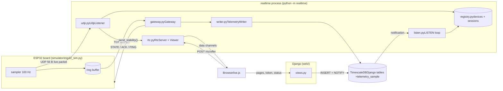
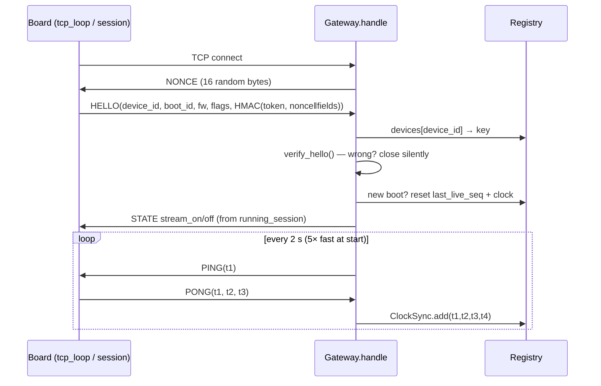
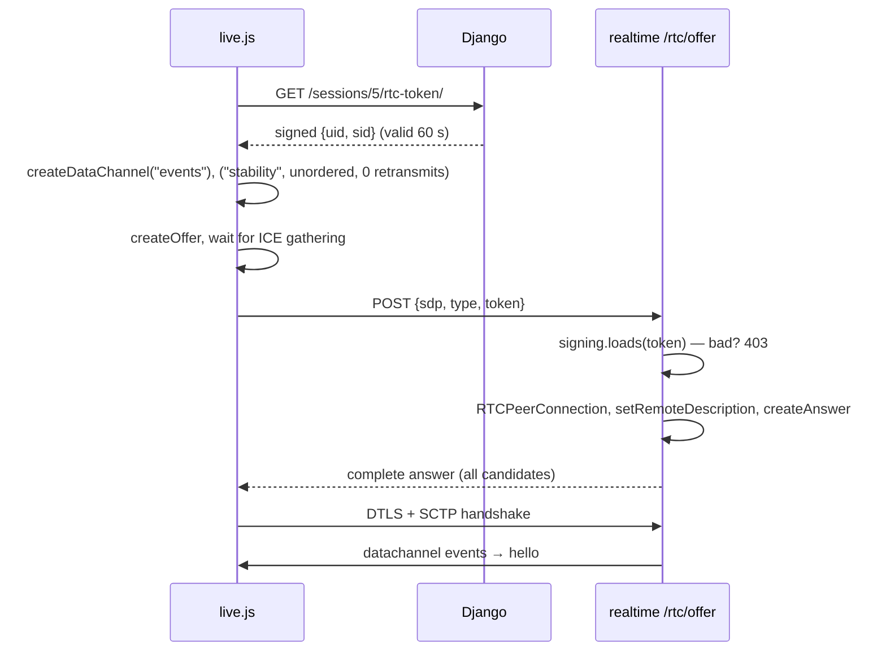

## Start here

[The big picture](#big-picture) [Seven flows, end to end](#flows) [Known weak spots](#weak)

## Files

[`protocol/telemetry.py`](#f-telemetry) [`protocol/decode.py`](#f-decode) [`boards/models.py`](#f-models) [`boards/notify.py`](#f-notify) [`boards/telemetry_queries.py`](#f-queries) [`migrations/0002_…`](#f-migration) [`boards/views.py`](#f-views) [`static/boards/live.js`](#f-livejs) [settings, urls, demo_setup](#f-misc-web) [`realtime/__main__.py`](#f-main) [`realtime/service.py`](#f-service) [`realtime/registry.py`](#f-registry) [`realtime/udp.py`](#f-udp) [`realtime/gateway.py`](#f-gateway) [`realtime/writer.py`](#f-writer) [`realtime/rtc.py`](#f-rtc) [`realtime/listen.py`](#f-listen) [`realtime/stability.py`](#f-stability) [`realtime/config.py`](#f-config) [`simulator/esp32_sim.py`](#f-sim) [`tools/viewer_client.py`](#f-viewer)

SCRUM-199 · example implementation

# Board telemetry, function by function

A guided read of the example built from the spike: what each function does, who calls it, and which part of the system it belongs to. Read “The big picture” and the flows first. The file reference is for looking things up.

## The big picture

There are four programs and one database. Only `realtime` talks to the board, and only `realtime` talks WebRTC. Django never sees a packet.



All the traffic runs along four paths. Keeping them apart is what the design is about.

live path**Board → screen in \~10 ms**

UDP packet → `datagram_received` → `Viewer.send_stability` → unordered data channel → `requestAnimationFrame`. In memory, no DB.

record path**Nothing is lost**

Ring buffer → TCP `BATCH` → `_handle_batch` → `insert` (dedup) → `ACK`. Slow is fine; complete is the goal.

control path**Who streams, when**

Trainer clicks → `start_session` → `pg_notify` → `listen_forever` → `on_event` → `push_state` → board.

viewer path**Joining the live view**

`rtc_token` (Django signs) → `connect()` in live.js → `offer()` in realtime (verifies) → two data channels.

## Seven flows, end to end

Each flow lists the functions in the order they run. Function names link to their reference entry.

### 1 · The board powers on and connects



1. [`Board.tcp_loop`](#fn-tcp_loop) opens the socket and hands it to [`Board.session`](#fn-sim-session).
2. [`Gateway.handle`](#fn-handle) calls [`_authenticate`](#fn-authenticate), which sends a fresh nonce and checks the HELLO with [`verify_hello`](#fn-verify_hello). The token is never sent; the board proves it knows it.
3. If the `boot_id` is new, the device's stale-seq marker and clock estimate are reset, because seq starts again at 0 after a reboot.
4. [`Registry.mark_device`](#fn-mark_device) writes `online=True`, firmware and power-save flag to the Django `Device` row. This is the online status on the dashboard.
5. [`push_state`](#fn-push_state) tells the board whether to stream; [`_ping_loop`](#fn-ping_loop) starts the clock sync.

### 2 · The trainer starts a session

1. The Start button posts to [`views.start_session`](#fn-start_session). Inside one transaction it creates the `Session` row and calls [`notify_realtime("session_started", …)`](#fn-notify_realtime).
2. If the board already has a running session, the partial unique constraint raises `IntegrityError` and the view shows an error. One running session per board is enforced by the database, not by code.
3. On commit, Postgres delivers the notification to [`listen_forever`](#fn-listen_forever), which calls [`Service.on_event`](#fn-on_event).
4. `on_event` calls [`Registry.refresh_session`](#fn-refresh_session) (re-reads the row through the ORM) and then [`Gateway.push_state`](#fn-push_state), which sends `STATE stream_on` down the board's TCP connection.
5. The board's [`sampler`](#fn-sampler) sees `streaming = True` and starts producing samples at 100 Hz.

### 3 · A viewer opens the live page



1. [`views.live`](#fn-live) renders the page; [`views.rtc_token`](#fn-rtc_token) checks `Session.can_view` and signs a token.
2. [`connect()`](#fn-connect) in live.js creates both channels *before* the offer, waits in [`iceGatheringComplete`](#fn-iceGatheringComplete), then POSTs.
3. [`RtcServer.offer`](#fn-offer) verifies the token, finds the session in the registry, builds a [`Viewer`](#fn-viewer) and returns the answer.
4. When the channels open, the inner `on_datachannel` stores them on the Viewer and adds it to `session.viewers`. From then on, every live packet for this session reaches it.

### 4 · One live sample, board to screen

This is the path the 50 ms budget is about. Every step runs on one event loop with no `await`.

1. [`Board.sampler`](#fn-sampler) calls [`measure()`](#fn-measure), packs the sample ([`Sample.pack`](#fn-pack)), appends it to the ring buffer, and sends a 56-byte packet built by [`encode_message`](#fn-encode_message).
2. [`UdpListener.datagram_received`](#fn-datagram_received) runs ten checks and steps, from size check to fan-out (annotated below).
3. [`Viewer.send_stability`](#fn-send_stability) calls `channel.send()` and remembers when it sent that seq.
4. In the browser, [`onStability`](#fn-onStability) drops anything older than what it already has and keeps only the newest sample; [`frame()`](#fn-frame) draws it on the next animation frame.

### 5 · A batch is stored and acknowledged

1. Every batch interval, [`Board.batcher`](#fn-batcher) sends all buffered samples newer than `last_sent` as one `BATCH` frame.
2. [`Gateway.handle`](#fn-handle) reads the frame ([`read_frame`](#fn-read_frame)) and calls [`_handle_batch`](#fn-handle_batch).
3. `_handle_batch` decodes and checks the tag ([`decode_message`](#fn-decode_message)), assigns every sample to a session by its own corrected time ([`session_for_sample`](#fn-session_for_sample)), and calls [`TelemetryWriter.insert`](#fn-insert).
4. `insert` returns only after COMMIT. Then the gateway sends `ACK(boot, last_seq)`.
5. The board's ACK handler in [`Board.session`](#fn-sim-session) frees buffer entries up to that seq.

### 6 · Wi-Fi drops and comes back

1. [`Board.wifi_chaos`](#fn-wifi_chaos) sets `wifi_up = False` and aborts the TCP socket. UDP sends stop; the sampler keeps filling the buffer.
2. On the server, `handle`'s `finally` block marks the device offline and [`broadcast_board_status`](#fn-broadcast_board_status) tells viewers. The browser's [`updateWarnings`](#fn-updateWarnings) shows “Live connection lost” after 1 s without data.
3. When Wi-Fi returns, `tcp_loop` reconnects and `session` sets `last_sent = last_acked`, so the next batch resends everything not yet acknowledged.
4. Anything that was stored but whose ACK got lost comes in again; `ON CONFLICT DO NOTHING` drops it and the log shows “N duplicate”.
5. If the drop outlasted the buffer (`--buffer-samples`), the oldest samples are gone. They become a gap at the end of the session.

### 7 · The session ends and is finalised

1. [`views.stop_session`](#fn-stop_session) sets `status=ended`, `ended_at=now` and notifies.
2. [`on_event`](#fn-on_event) refreshes the session (now with an end time), sends `STATE stream_off`, tells viewers, and calls [`_schedule_finalise`](#fn-schedule_finalise).
3. The session stays in the registry for the grace period (30 s in the demo, about 10 min in production), so late resends still land in it.
4. After the grace period, [`finalise_session`](#fn-finalise_session) runs the gap query and writes the result to `Session.gaps`. Then the session is removed from the registry and remaining viewers are closed.

## Known weak spots

**Database outage blocks batches.** `_handle_batch` doesn't catch DB errors. While the DB is down each insert waits for psycopg's pool timeout (30 s), and frames queue up behind it. Fix: catch the error, skip the ACK, continue. The board resends anyway. Seen in practice when the containers were stopped.

**Session match at the edges.** A sample's session is picked by the clock-corrected time. If the offset estimate changes between a send and a resend, a sample right at a session boundary could be assigned differently. Dedup still works because the unique index uses the board's raw time.

**Placeholders.** The score formula (`demo-0`), the 200 mm half-span, the kg unit and plain TCP instead of TLS are all marked as placeholders in the code.

## File reference

Every function, grouped by file. **Called by** says who uses it; **Part of** says which path from the big picture it serves.

### protocol/telemetry.py

The wire format. Shared by the server, the simulator and the decoder, so every byte is defined once.

| Part | Struct | Size | Fields |
| --- | --- | --- | --- |
| Header | `<BBHII` | 12 B | version, msg_type (1 live, 2 batch), count, device_id, boot_id |
| Sample | `<QI4f2hBBH` | 36 B | t_us, seq, 4 load cells (FL FR BL BR), roll, pitch (0.01°), actuator, mode, flags |
| Tag | raw | 8 B | HMAC-SHA256(token, header + samples), first 8 bytes |

Sample.pack(self) → bytes

Turns one decoded sample into its 36 bytes. Roll and pitch are converted from degrees to 0.01° integers via `_deg_to_i16`.

**Called by** simulator `sampler`, tests**Part of** live + record paths (board side)

Sample.unpack_from(buf, offset) → Sample

The reverse: reads 36 bytes at a fixed offset and converts the angles back to degrees. Fixed offsets are why decoding is cheap.

**Called by** `decode_message`, `datagram_received`, decoder**Part of** live + record paths

\_deg_to_i16(deg) → int

Rounds to 0.01° and clamps to the i16 range so a wild IMU value can't overflow the struct.

**Called by** `Sample.pack`

compute_tag(key, data) → 8 bytes

HMAC-SHA256 truncated to 8 bytes. The key is the device token from BLE pairing. This is what stops anyone on the internet from injecting data into the public UDP port.

**Called by** `encode_message`, `verify_tag`**Part of** security

verify_tag(key, data, tag) → bool

Recomputes the tag and compares in constant time (`hmac.compare_digest`) so timing doesn't leak how many bytes matched.

**Called by** `datagram_received`, `decode_message`, decoder

encode_message(key, msg_type, device_id, boot_id, samples_packed) → bytes

Builds header + samples + tag. Takes samples that are *already packed*, because the board stores them packed in its buffer; building a batch is just concatenation, like `memcpy` on the ESP32.

**Called by** simulator `sampler` (live) and `batcher` (batch)**Part of** board side

peek_header(data) → Header

Parses only the header and checks version, type and that the total length equals `12 + 36·count + 8` exactly. The server needs the `device_id` to find the key *before* it can check the tag, and wants to reject junk cheaply.

**Called by** `datagram_received`, `decode_message`

decode_message(key, data) → (Header, \[Sample\])

Full validation: header checks, then tag, then unpacks every sample. Raises `ProtocolError` on anything wrong.

**Called by** `Gateway._handle_batch`**Part of** record path

frame(ftype, payload) → bytes

Wraps a TCP message as `length u32 | type u8 | payload`. A length prefix is how a TCP byte stream is cut back into messages.

**Called by** gateway and simulator for every frame**Part of** control + record paths

async read_frame(reader) → (ftype, payload)

Reads exactly one frame from an asyncio stream. Rejects absurd lengths (bigger than the biggest legal batch) before allocating memory for them.

**Called by** `Gateway.handle`, `_authenticate`, simulator `session`

hello_payload(key, nonce, device_id, boot_id, fw, flags) → bytes

Board side of the challenge: the 11 HELLO fields plus HMAC over `nonce + fields`.

**Called by** simulator `session`

parse_hello(payload) → (device_id, boot_id, fw, flags, fields, mac)

Splits a HELLO without verifying it. Verification needs the key, and the key lookup needs the device_id from here.

**Called by** `_authenticate`

verify_hello(key, nonce, fields, mac) → bool

Server side of the challenge. Because the nonce is fresh per connection, a recorded HELLO is useless to an attacker.

**Called by** `_authenticate`**Part of** security

centre_of_pressure(lc) → (x_mm, y_mm)

Weighted average of where the four cells sit: `x = L·((FR+BR)−(FL+BL))/total`, same for y with front minus back. Returns (0, 0) when nobody stands on the board. Shared so the simulator and server agree on geometry.

**Called by** `datagram_received`, decoder**Part of** live path (SCRUM-155)

### protocol/decode.py

Debugging tool for the binary format (SCRUM-148 asks for one).

describe(data, key) → str

Human-readable dump of a message: header, tag status, first five samples with their CoP. Never raises; invalid input becomes “INVALID: reason”.

**Called by** `main`

main()

Either decodes a hex string from the command line, or with `--listen PORT` prints every UDP packet that arrives. Point the simulator at that port to see the raw wire.

**Run as** `python -m protocol.decode`

### web/boards/models.py

The little state Django owns: boards and sessions.

new_device_token() → str

Default for `Device.token`: 32 random hex characters. This token is both the HELLO secret and the UDP HMAC key.

class Device

One board. Its primary key is the `device_id` in every packet. `online`, `last_seen`, `firmware` and `wifi_powersave` are written by `realtime`, not by Django.

**Read by** `Registry.load_all`, dashboard

class Session · constraint one_running_session_per_device

One session on one board. `started_at`/`ended_at` are the time window used to assign samples. `gaps` stays NULL until `realtime` finalises the session. The partial unique constraint (`UNIQUE(device) WHERE status='running'`) enforces SCRUM-151's “one running session per board”.

Session.can_view(user) → bool

Staff, the trainer or the participant may watch. Checked by Django before it signs a viewer token.

**Called by** `live`, `rtc_token`, `session_status`

### web/boards/notify.py

Django's half of the Django → realtime event channel.

notify_realtime(event, \*\*ids)

Runs `SELECT pg_notify('realtime', '{"event":…}')` in the current transaction. Postgres sends it only on COMMIT, so `realtime` never hears about a session that was rolled back. The payload carries ids only; the receiver re-reads the row.

**Called by** `start_session`, `stop_session`**Received by** `listen_forever`**Part of** control path

### web/boards/telemetry_queries.py

Read-only SQL on the hypertable, shared by Django and realtime.

GAPS_SQL

Uses `LEAD(seq) OVER (PARTITION BY boot_id ORDER BY seq)` to compare each stored row with the next one. Seq goes up by exactly 1 per sample, so any jump above 1 is a hole.

```
seq:      … 760  761  1328  1329 …
next_seq: … 761  1328 1329  1330 …
                ↑ 1328 − 761 > 1  →  gap 762–1327 (566 missing)
```

session_gaps(session_id) → \[ {boot_id, from, to, missing} \]

Runs `GAPS_SQL` through Django's connection. Shown live on the dashboard before a session is final.

**Called by** `dashboard`, `session_status`

session_stats(session_id) → {samples, boots, min_seq, max_seq}

Counts what the TCP batches have stored so far: the “Stored record” panel.

**Called by** `dashboard`, `session_status`

### web/boards/migrations/0002_telemetry_hypertable.py

Creates the telemetry table with raw SQL, so Django stays the single owner of the schema.

CREATE TABLE telemetry_sample … create_hypertable(…) … UNIQUE (device_id, boot_id, seq, ts)

One row per sample, partitioned by day. Two decisions matter:

- `ts` is the board's raw timestamp, not the corrected one. A resent sample must produce an identical row or the unique index would miss it. The correction used is stored next to it in `clock_offset_us`.
- The unique index includes `ts` because TimescaleDB requires the time column in every unique index on a hypertable.

### web/boards/views.py

Pages and small JSON endpoints. No view touches a packet.

dashboard(request)

Lists the user's boards (online state comes from realtime's writes) and recent sessions with stored sample counts and gaps.

start_session(request) · POST

Creates the session and notifies in one `transaction.atomic()`. Catches `IntegrityError` from the one-running-session constraint and shows a message. Redirects to the live page.

**Part of** control path

stop_session(request, session_id) · POST

Locks the row (`select_for_update`), sets ended + end time, notifies. Doing nothing for an already-ended session keeps a double click harmless.

live(request, session_id)

Renders `live.html` and passes the realtime URL and ICE servers to the page.

rtc_token(request, session_id) → {"token"}

Signs `{uid, sid}` with Django's `SECRET_KEY` and a salt. `realtime` verifies it with the same key, so it doesn't need a DB call or a shared cookie. Valid for 60 s; the page gets a fresh one every time it connects.

**Called by** live.js `connect()`**Verified by** `RtcServer.offer`**Part of** viewer path

session_status(request, session_id) → JSON

Status, stored-sample stats and gaps, polled every 2 s by the page for the “Stored record” panel. This is the record path made visible, separate from the live stream.

### web/boards/static/boards/live.js

The browser's WebRTC client and drawing loop.

async connect()

The whole viewer handshake: fetch token → new `RTCPeerConnection` → create `events` (reliable) and `stability` (`ordered:false, maxRetransmits:0`) → offer → wait for ICE → POST → apply answer. Any failure goes to `scheduleReconnect`.

```
events = pc.createDataChannel("events");              // transcript, warnings, latency: must arrive, in order
stability = pc.createDataChannel("stability", {
  ordered: false, maxRetransmits: 0 });                 // a late sample is worthless: never wait for it
```

**Talks to** `views.rtc_token`, `RtcServer.offer`**Part of** viewer path

iceGatheringComplete(pc) → Promise

Waits until the browser has all its ICE candidates (or 2 s), so the offer is complete and nothing needs trickling. This is why no WebSocket or Django Channels is needed.

scheduleReconnect()

Closes the old peer and calls `connect()` again after 2 s. Covers a `realtime` restart, which drops every peer (tested: the page came back on its own).

onStability(m)

Runs for every message (about 100/s). Resets the seq check when `boot` changes, drops anything not newer than the last seq (the channel is unordered), and stores the message in `latest`. It doesn't draw.

**Part of** live path, last hop

onEvent(m)

Handles `events` messages: `hello`, `latency`, `board` online/offline, `session_ended`. Everything else is written to the log panel.

echo timer (setInterval 1 s)

Sends `{type:"echo", seq, boot}` for the seq last drawn, only if it is newer than the last echo. The server turns this into server → screen latency. The “only newer” check was a bug fix: echoing the same stale seq made latency look like it grew every second.

frame()

The `requestAnimationFrame` loop (about 60/s). If a new sample is waiting, updates the numbers and calls `drawCop` and `drawSpark`. Always calls `updateWarnings`. Drawing once per frame instead of once per message is what keeps 100 Hz data cheap.

drawCop() · drawSpark()

`drawCop` draws the board (±200 mm), a 50 mm target circle, the last second of trail and the current CoP dot. `drawSpark` draws the last 30 s of score as a dashed teal line (stability style from SCRUM-198).

updateWarnings()

Fills the latency panel and shows the red banner when no data arrived for 1 s or total latency is above 500 ms (SCRUM-152/195).

pollStatus() · setConn() · log()

`pollStatus` fetches `session_status` every 2 s; `setConn` updates the connection pill; `log` prepends a line to the events panel.

### settings.py · urls.py · demo_setup.py

Configuration and setup.

settings.py

Postgres via env vars, `SECRET_KEY` (must match between Django and realtime because of the signed tokens), `REALTIME_PUBLIC_URL` for the page. `realtime` loads these same settings.

urls.py

Admin, login/logout, and the six board routes: dashboard, start, stop, live, rtc-token, status.

demo_setup.Command.handle()

Creates user `demo` and Device #1 with the fixed token `demo-token-1`, so the simulator's defaults just work.

### realtime/\_\_main\_\_.py

Entry point for `python -m realtime`.

main()

Adds `web/` to the path and calls `django.setup()`, so models and settings work without Django's request machinery. Sets up logging, then runs `Service().run()`. On Windows it forces a selector event loop because psycopg's async mode needs one.

### realtime/service.py

Wires everything together on one event loop and reacts to Django's events.

Service.\_\_init\_\_()

Builds the one `Registry`, `TelemetryWriter`, `UdpListener`, `Gateway` and `RtcServer`. They all share the same registry object, which is the point of the one-process design.

async run()

Start-up order matters: open the DB pool → start the LISTEN loop → **wait until the registry is loaded** → open UDP 9000, TCP 9001 (TLS if configured) and HTTP 8080 → start the latency reporter. Packets that arrive before the devices are known would all be dropped, hence the wait.

async on_db_connected()

Runs after every (re)connect of the LISTEN connection: full registry reload, schedule finalising for ended sessions, push current STATE to every connected board.

**Called by** `listen_forever`

async on_event(ev)

The control-path dispatcher. `session_started` → refresh + stream_on. `session_ended` → refresh + stream_off + tell viewers + schedule finalise. `device_changed` → reload the device (for example after a token rotation).

**Called by** `listen_forever`**Part of** control path

\_schedule_finalise(session_id) · inner finalise()

Starts one background task per ended session: sleep for whatever is left of the grace period, run `finalise_session`, drop the session from the registry, close its viewers. A dict of tasks prevents scheduling the same session twice.

broadcast_board_status(device_id, online)

Sends `{type:"board", online}` to every viewer of every session on that board. Called when a board connects or disconnects.

async latency_reporter()

Every second, sends each viewer its numbers on `events`: board → server p50/p95, its own server → client, the total and the clock offset. Every 5 s also logs a summary line per running session (SCRUM-180).

### realtime/registry.py

In-memory state so the live path never waits for the database.

now_us() · dt_to_us(dt)

Server clock in microseconds, and a datetime converted to the same unit, so all time comparisons use one scale.

ClockSync.add(t1, t2, t3, t4) · .offset_us · .best_rtt_us

NTP-style clock sync between board and server. Keeps the last 8 measurements and trusts the one with the lowest round trip, because queueing delay only ever adds time.

```
# server sends PING at t1 (server clock); board receives at t2, replies at t3 (board clock);
# server receives the PONG at t4 (server clock).
rtt    = (t4 - t1) - (t3 - t2)          # time spent on the network only
offset = ((t2 - t1) + (t3 - t4)) / 2    # board clock minus server clock
# exact if both directions take equally long; the error is half the asymmetry.
# Demo: board skewed by +250 ms → measured 250.0 ms.
```

**Fed by** `Gateway.handle` (PONG)**Used by** `datagram_received`, `_handle_batch`

LatencyStats.add(ms) · .percentile(p)

Last 1,000 board → server latencies (about 10 s at 100 Hz) and their percentiles.

DeviceState · SessionState (.running, .contains)

`DeviceState` holds everything a packet needs: HMAC key, current boot from HELLO, highest live seq, TCP connection, clock sync. `SessionState` holds the time window, the set of viewers, the rolling score and latency stats. `contains(t)` is the “does this sample belong here” test.

\_fresh_db()

Calls Django's `close_old_connections` before ORM work. A long-running process never goes through a request cycle, so without this a dead DB connection would never be replaced.

async Registry.load_all() → \[sessions to finalise\]

Full reload from Postgres through the ORM: all devices, plus sessions that aren't finalised yet. Sessions that ended longer ago than the grace period are returned for immediate finalising instead of being loaded.

**Called by** `on_db_connected`

\_upsert_device(d) · \_upsert_session(s)

Create or update one in-memory entry from an ORM row. Updating in place keeps live objects (the TCP connection, the viewer set) attached across reloads.

async refresh_session(id) · refresh_device(id)

Re-read one row after a NOTIFY. If the row is gone, drop it from memory.

**Called by** `on_event`

running_session(device_id)

The running session for a board, or None. A linear scan over a handful of sessions; no awaits, so it is safe on the hot path.

**Called by** `datagram_received`, `push_state`

session_for_sample(device_id, t_server_us)

The session whose window contains a sample's corrected time, including ended sessions within grace. This is how a batch resent late still lands in the right session.

**Called by** `_handle_batch`

async mark_device(device_id, \*\*fields)

Writes online / last_seen / firmware / power save to the Django `Device` row (SCRUM-151 online status).

**Called by** gateway on connect, every 5 s of traffic, and disconnect

### realtime/udp.py

The latency-critical live path.

UdpListener.\_\_init\_\_(registry) · \_drop(reason, dev)

`_drop` just counts the drop reason. Every rejection is silent, so a scanner learns nothing and a real board doesn't care about one lost live sample.

datagram_received(data, addr)

Called by asyncio for every UDP packet. Synchronous from top to bottom:

```
recv_us = now_us()                           # 0. timestamp first, before any work
if len(data) != 56: drop("size")            # 1. most junk dies here
h = peek_header(data)                        #    version / type / count
dev = registry.devices.get(h.device_id)      # 2. unknown device → drop
verify_tag(dev.key, body, tag)               # 3. HMAC with this board's token
h.boot_id == dev.boot_id                     # 4. must match the authenticated HELLO → blocks old replays
s.seq > dev.last_live_seq                    # 5. stale/duplicate → skip, never block
session = registry.running_session(dev.id)   # 6. server-side matching; board doesn't know the session
latency = recv_us - (s.t_us - offset)        # 7. board→server, with the corrected board clock
cop = centre_of_pressure(s.lc)               # 8. CoP + O(1) rolling score
score = session.stability.add(cop, roll, pitch)
msg = json.dumps({"type":"stability", …})    # 9. ~110 bytes, SCRUM-80 type + payload
for viewer in session.viewers:              # 10. fan out: plain method call, no broker
    viewer.send_stability(msg, boot, seq)
```

**Called by** asyncio's datagram endpoint**Part of** live path

error_received(exc)

Ignores ICMP errors that Windows reports on UDP sockets.

### realtime/gateway.py

The board's one persistent TCP connection: auth, control, batches, clock, presence.

BoardConnection.send(ftype, payload) · close()

Writes one frame without blocking (StreamWriter buffers). Used by `push_state`, ACK and PING.

Gateway.push_state(device_id)

Sends `STATE(stream_on, batch_interval_ms, sample_rate_hz)`. `stream_on` is simply “does this board have a running session”. If the board is offline, nothing happens; it gets STATE on its next HELLO.

**Called by** `handle`, `on_event`, `on_db_connected`**Part of** control path

async Gateway.handle(reader, writer)

One call per board connection, alive as long as the connection. Authenticates, replaces any stale connection from the same board (common after a Wi-Fi drop, where no FIN ever arrived), sends STATE, starts pinging, then loops: `BATCH` → `_handle_batch`, `PONG` → `ClockSync.add`. A 15 s idle timeout catches silent deaths. The `finally` block marks the device offline, unless a newer connection has already taken over.

**Called by** `asyncio.start_server`

async \_authenticate(reader, writer) → DeviceState | None

NONCE → HELLO challenge. Gives the same answer (close) for unknown device and wrong token, so a scanner can't learn which ids exist. Handles a new boot (resets seq and clock) and warns if Wi-Fi power save is on, which would cost up to \~300 ms of latency.

async \_ping_loop(conn)

Five PINGs 100 ms apart for a quick first clock estimate, then one every 2 s, which also works as a keep-alive.

async \_handle_batch(conn, payload)

The record path's server side:

```
h, samples = decode_message(dev.key, payload)     # length, version, tag
for s in samples:
    session = session_for_sample(dev.id, s.t_us - offset)   # by the sample's own time
    rows.append((board_time(s.t_us), offset, session.id, …)) # raw board time → dedup works
inserted = await writer.insert(rows)               # returns after COMMIT
conn.send(ACK, (boot, samples[-1].seq))            # only now: never ACK what isn't durable
```

If the process crashes between commit and ACK, the board resends and the unique index drops the copies. See [weak spots](#weak) for what happens when the DB is down.

**Called by** `handle`**Part of** record path

### realtime/writer.py

psycopg 3 async pool → TimescaleDB.

conninfo_from_django() · board_time(t_us)

`conninfo_from_django` builds a psycopg connection string from Django's settings, so there is one DB config. `board_time` turns microseconds into a timestamp with integer maths, so the same `t_us` always becomes the same `ts`.

TelemetryWriter.\_\_init\_\_ · open() · close()

Pool of 1–4 connections, opened at start-up and closed on shutdown.

async insert(rows) → new_row_count

`executemany` of `INSERT … ON CONFLICT DO NOTHING`. The return value counts only new rows, which is how the log shows “N new, M duplicate”. COPY would be faster but can't do ON CONFLICT.

**Called by** `_handle_batch`

async finalise_session(session_id) → gaps

Runs `GAPS_SQL` once the grace period is over and saves the result to `Session.gaps` through the ORM. Whatever is still missing now will never arrive (SCRUM-153 gap flag).

**Called by** `_schedule_finalise`

### realtime/rtc.py

aiortc peers and HTTP signalling.

class Viewer

One browser watching one session: its peer connection, both channels, and a small dict of when each `(boot, seq)` was sent.

Viewer.send_stability(msg, boot, seq)

Called from the UDP hot path, so it is synchronous and cheap. Skips if the channel isn't open; drops the message if more than 64 KB is already queued (backpressure: newer data is behind it anyway); records the send time, keeping the last 512.

**Called by** `datagram_received`**Part of** live path

Viewer.send_event(payload)

JSON on the reliable `events` channel: hello, latency, board status, session ended.

Viewer.on_event_message(raw)

Handles the client's echo: looks up (and removes) the send time for that seq, halves the round trip, smooths it. Removing it means a repeated echo can't produce a growing bogus value.

RtcServer.app() · \_cors · preflight · health

Builds the aiohttp app with `POST /rtc/offer`, its CORS preflight (only needed in the demo because the page is on port 8000) and `GET /healthz`, which shows peers, online boards, sessions and UDP drop counters.

async RtcServer.offer(request)

The whole signalling step. Verifies the Django-signed token (403 if bad or older than 60 s), finds the session (404 if not active), creates the peer and Viewer, registers two callbacks, and returns a complete answer:

- `on_datachannel`: stores `events` or `stability` on the Viewer, sends `hello`, adds the viewer to `session.viewers`.
- `on_state`: on failed/closed, removes the viewer and closes the peer.

**Called by** live.js `connect()`, `viewer_client.run`**Part of** viewer path

\_close_all()

Closes every peer on shutdown.

### realtime/listen.py

realtime's half of the event channel.

async listen_forever(conninfo, on_connected, on_event)

Keeps one autocommit connection with `LISTEN realtime`. After every (re)connect it calls `on_connected` (full reload) *after* LISTEN is active, so no event can slip through between reading the DB and starting to listen. Then it hands each notification to `on_event`. On connection loss it retries every 2 s, which is what you saw when the containers stopped.

### realtime/stability.py

Rolling stability score, O(1) per sample.

RollingStability.add(cop, roll, pitch) → score

Smooths the CoP (an exponential moving average, otherwise sensor noise alone adds a large fake path length at 100 Hz), adds the new path segment and tilt² to running sums, and removes the oldest sample once the window (200 samples = 2 s) is full. Every 10,000 samples it recomputes the sums to cancel floating-point drift.

RollingStability.score() → 0–100

`100 − sway speed (mm/s) − 10 × tilt RMS (°)`, clamped. A placeholder formula (`demo-0`) until SCRUM-190. Standing still gives about 92; 30 mm sway gives about 35.

### realtime/config.py

Every tunable, from environment variables.

| Variable | Default | Meaning |
| --- | --- | --- |
| `REALTIME_BIND` | 127.0.0.1 | Use 0.0.0.0 on the VPS or for a real ESP32 |
| `REALTIME_UDP_PORT / TCP_PORT / HTTP_PORT` | 9000 / 9001 / 8080 | Live, gateway, signalling |
| `REALTIME_TLS_CERT / TLS_KEY` | empty | Both set → gateway uses TLS |
| `REALTIME_BATCH_INTERVAL_MS` | 2000 | Sent to the board in STATE (SCRUM-153) |
| `REALTIME_SESSION_GRACE_S` | 30 | How long ended sessions accept late resends |
| `REALTIME_STABILITY_WINDOW` | 200 | Samples in the rolling score |
| `REALTIME_ALLOWED_ORIGINS` | localhost:8000 | CORS for the demo |
| `REALTIME_ICE_SERVERS` | empty | STUN/TURN for aiortc |

### simulator/esp32_sim.py

Behaves like the firmware should (SCRUM-158). Four tasks run at once in `Board.run`.

Board.\_\_init\_\_(args)

Random `boot_id`, seq at 0, a bounded ring buffer (`deque(maxlen=…)`, like real RAM), `last_acked` and `last_sent` markers, a UDP socket.

board_us() · log(msg)

`board_us` is the board clock: real time plus `--clock-offset-ms`, to simulate bad SNTP. `log` prints with seconds since start.

measure() → Sample

Fake sensors. Makes a CoP path (sway: two sine waves per axis; still: 0.3 mm noise), then derives the four load cells from it, so the server's CoP formula recovers exactly that path. Roll and pitch follow the CoP slightly. Increments seq.

async sampler()

Fixed-rate loop that sleeps until an absolute next tick, so timing doesn't drift. While streaming: measure → append to buffer → send UDP live packet (unless Wi-Fi is down or `--loss` says drop).

**Part of** live + record paths, board side

async tcp_loop()

Connect forever with backoff (0.5 s doubling to 5 s). Waits while Wi-Fi is down. Keeps `streaming` unchanged on disconnect: a Wi-Fi drop doesn't end the session.

async session(reader, writer)

One connection's life on the board: answer NONCE with HELLO, set `last_sent = last_acked` (resend everything unacknowledged), start the batcher, then handle frames. `STATE` sets streaming, interval and rate. `ACK` frees the buffer up to the seq (or is ignored with `--ack-loss`, to force duplicates). `PING` → `PONG(t1, t2, t3)`.

unacked() → int

How many buffered samples the server hasn't confirmed yet. Used in log lines.

async batcher(writer)

Every batch interval, sends everything after `last_sent`, at most `--max-batch` samples per frame, looping until the backlog is empty. Keeps flushing after stream_off until the buffer is empty.

async wifi_chaos()

Fault injection: at `--wifi-drop-at`, turns Wi-Fi off for `--wifi-drop-for` seconds and aborts the TCP socket. Optionally repeats.

async status() · async run() · main()

`status` prints counters every 5 s. `run` starts sampler, tcp_loop, wifi_chaos and status together. `main` parses the options listed in the README.

### tools/viewer_client.py

live.js in Python, for testing without a browser and as a load-test seed (SCRUM-144).

mint_token(session_id) → str

Sets up Django and signs a viewer token itself, as the session's trainer. A dev shortcut for what `rtc_token` does after login.

async run(args) · on_stability · on_event

Same channels and same stale-seq rule as the browser, then one line per second: messages/s, stale count, CoP, score, latencies, clock offset. Echoes the newest seq once per second.

main()

Options: `--session`, `--url`, `--seconds`.